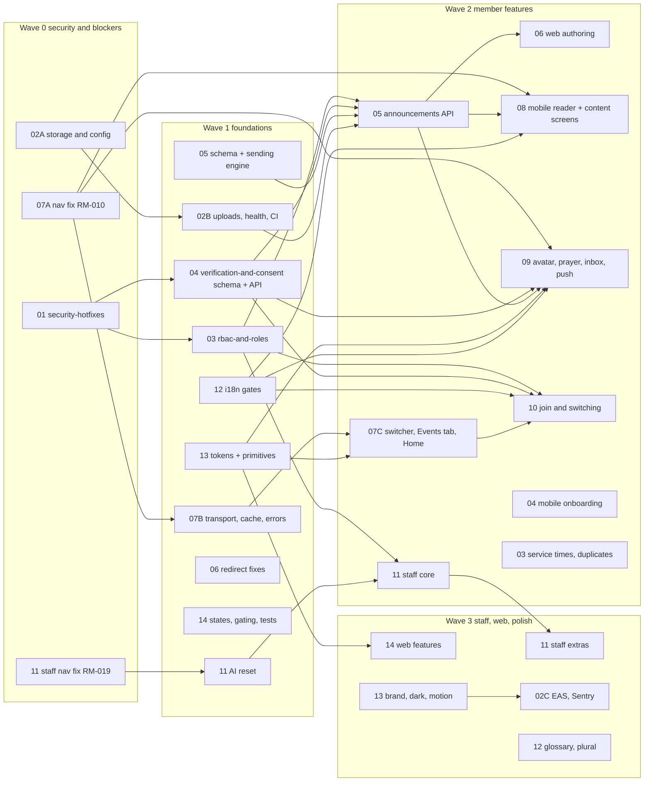

# Waves, dependency graph, merge order

Lanes are specs in `specs/`. IDs are rows in `backlog.md`. Wave counts: W0 19, W1 47, W2 32, W3 42 items (140 total).

## Dependency graph

Key edges:

- Permission names (lane 03) gate announcements (05), join (10) and prayer (09). Lane 03 publishes them first, in one small PR.
- Verification columns (lane 04, migration batch M1) gate verified-only delivery (05), avatar (09) and email-bound invites (10).
- Navigation fix (07A) gates every mobile screen lane, because it moves files into `(tabs)/`.
- Storage hardening (02) gates avatar and announcement images.
- `docs/roadmap/specs/lane-12` pre-registers message namespaces so feature lanes never edit the same i18n file.

## Launch order

### Wave 0 (parallel, four lanes, disjoint files)

| Lane | Start | Items |
|---|---|---|
| 01 security-hotfixes | day 1 | RM-001, 002, 003, 004, 009, 011, 012, 013, 014 |
| 02A storage-config | day 1 | RM-005, 006, 007, 015, 016, 018, then RM-008 with the owner |
| 07A navigation fix | day 1 | RM-010 |
| 11 staff navigation | day 1 | RM-019 (verify on a device first) |
| owner | day 1 | V-01, V-02, D-01, D-30, RM-017 (D-11) |

Wave 0 order inside lane 01: RM-001, 002, 003, 004 (one-line to small fixes, ship the same day), then 009, 013, 014, then 012 and 011 (larger web change, last). Deploy to DEV only with the owner's OK for the session; re-test with the member token: `GET /visitors` returns 403, `GET /events` has no drafts, library access returns a signed URL.

### Wave 1 (foundations; two migration batches)

Start when W0 lanes 01, 02A, 07A, 11 (RM-019) are merged.

| Order | Lanes | Notes |
|---|---|---|
| 1 | 03 (permissions PR first), 13A (tokens, primitives), 12 (gates and namespaces) | 03 publishes new permission names in the first hour; 12 publishes namespace stubs; 13A publishes primitives |
| 2 (parallel with 1) | 04 (schema then API), 05 (schema + engine), 02B, 07B, 06A, 14A, 11A | 04 and 05 write table TypeScript only |
| 3 | Integrator runs migration batches M1 then M2 | see below |
| 4 | 04 API tasks depending on migrated dev DB, 05 engine tests against dev | dev apply only with owner OK |

### Wave 2 (member features)

Start when M1 and M2 are applied on DEV, lane 03 permissions and lane 04 verification APIs merged, 07B merged.

| Group | Lanes (parallel) | Constraint |
|---|---|---|
| API | 05 (announcements API), 09-API (avatar, prayer, push), 10-API (invitations), 03B (service times, duplicates) | one migration batch M3 after 10-API and 09-API schema land |
| Web | 06 (authoring), 10-web (admin), 14 (portal feed) | after 05 contract merged |
| Mobile | 08, 09-mobile, 10-mobile, 04-mobile, 07C, 11B | 07C and 08 coordinate via the route table in lane 07; 10-mobile after 07C |

Critical path: 03 permissions, 04 schema, 05 schema, M1/M2, 05 API, then 06 + 08. Start lane 05 schema work in Wave 1 so the API can begin the moment M2 is applied.

### Wave 3 (staff, web features, polish)

Lanes 14B (web features), 13B (brand, dark mode, motion; brand wiring waits for D-12), 11C (staff extras), 02C (EAS, Sentry; D-10), 12B (glossary, plurals), 09 (accessible labels), 08 (giving history). Parallel; migration batch M4 only if a lane adds a table.

## Merge and integration order for shared files

| Shared file or area | Owner | Order and rule |
|---|---|---|
| `packages/config/src/permissions.ts` | lane 01 until Wave 0 merges (only `MEMBER` grants and RM-001), then lane 03 | Lane 03 starts from merged lane 01. Feature lanes request permissions through lane 03's first PR (names fixed in lane 03 spec). |
| `packages/db/tables/user.ts` | lane 04 | Includes `usher` enum value (requested by lane 03) and avatar columns (requested by lane 09). |
| Other `packages/db/tables/*.ts` | one lane per file (see each spec) | Never two lanes on a table file. |
| `packages/db/migrations/**`, `meta/_journal.json` | integrator | Lanes never generate migrations (see batches below). |
| `packages/db/tables/relations.ts`, tables index export | integrator | Lanes report the relations and exports they need; integrator appends in merge order. |
| `packages/config/src/i18n/**` | lane 12 for `index.ts`, existing files, tests; each feature lane owns one new file `messages/<lane-namespace>.ts` pre-registered by lane 12 | Lane 12 merges first in each wave. After i18n edits run `pnpm --filter @church/config build`. |
| `packages/config/src/utils/phone.ts` (new) | lane 04 | Re-export via package index by integrator. |
| `pnpm-lock.yaml`, all `package.json` | integrator | One dependency batch at the start of each wave (list below). |
| `apps/api/src/app.module.ts`, `apps/api/src/main.ts` | `main.ts` lane 02; `app.module.ts` integrator | Lanes adding a Nest module report the import line; integrator applies in merge order. |
| `apps/mobile/app.json`, `eas.json` | lane 02 | Lane 02 adds image-picker, camera and notification plugin entries and permission strings in its dependency batch task. |
| `apps/mobile/app/(member)/_layout.tsx` and tabs | lane 07 | Routes added by other lanes go through lane 07's route table (spec). |
| `apps/mobile/components/ui/**`, `theme/**` | lane 13 | Other lanes consume only. |

### Dependency batches (integrator runs `pnpm add`, one commit, lockfile only)

| Wave | Packages |
|---|---|
| 0 | none |
| 1 | `apps/web`: `@tiptap/react`, `@tiptap/starter-kit`, `@tiptap/extension-link`, `@tiptap/extension-image`; `apps/api`: `sharp`, `@nestjs/schedule` (already present, confirm), `expo-server-sdk`; `apps/mobile`: `expo-image-picker`, `expo-image-manipulator`, `expo-image`; dev: `eslint-plugin-jsx-a11y` (web); new workspace package `packages/ui-tokens` wired into the workspace and turbo |
| 2 | `apps/mobile`: `expo-notifications`, `expo-device`, a persistent store for the offline queue (`@react-native-async-storage/async-storage`; not installed today, only `expo-secure-store` is), `expo-camera` (Wave 3 QR) |
| 3 | `lucide-react-native`, `react-native-reanimated` only if D-12/RM-121 proceed; `@sentry/*` |

Confirm exact versions against Expo SDK 58 (`npx expo install` picks compatible ones). Do not use a package until the batch is merged.

### Migration batches (the baton)

Lanes write table TypeScript only. The integrator (coordinator, or a Haiku agent on its instruction) runs `pnpm --filter @church/db db:generate` once per batch, reviews the SQL, and commits. Dev apply needs the owner's OK for the session (DEC-12 applies only within an approved session); **prod migrations always need explicit owner approval and a fresh backup**.

| Batch | When | Content | Table owner lanes |
|---|---|---|---|
| M1 | end of Wave 1 step 2 | `users` verified and avatar columns, `roleEnum` + `usher`, `contact_verifications`, consent and opt-out | 04 |
| M2 | Wave 1 step 3 | `announcements`, `announcement_attachments`, `announcement_deliveries`, `notifications.church_id` (+ backfill), `communications` alterations | 05 |
| M3 | early Wave 2 | `church_invitations`; `membership_status` += `pending_approval` **in its own migration** (non-transactional `ALTER TYPE ADD VALUE`); `prayer_requests.visibility`; service time columns (`attendance.ts`) | 10, 09, 03 |
| M4 | Wave 2 end | `push_devices`, `notification_preferences` | 09 |

Order inside a batch: generate after merging all table files for the batch; never merge table changes for the next batch before the previous one is generated and committed.

## Exit criteria

### Wave 0
- On DEV with `mobile.test@mitoyabarakachurch.org`: `GET /visitors`, `/visitors/:id`, `/visitors/status/x` return 403; `GET /events` returns no draft; `GET /sms/notification/:ref` returns 403 for a non-SUPER_ADMIN.
- `PATCH /users/me` with `email` leaves the stored email unchanged.
- API refuses to boot with `NODE_ENV=production` and a missing or default `JWT_SECRET`/`SESSION_SECRET` (unit test).
- `POST /library/resources/:id/access` returns a signed URL on DEV; no "Resolved credential" in logs; non-HTTP errors return a generic message.
- `GET /api/auth/session` JSON on web has no `accessToken` or `refreshToken`.
- Staff: the check-in screen opens from Services and Back returns (RM-019), or the report states it was never broken.
- On a device or simulator: Home "See all", Prayer, Inbox, Events and Library catalogue open and Back returns; static route test passes.
- Targeted tests passed; one `tsc` per touched app; nothing deployed to PROD.

### Wave 1
- RBAC test generated from the matrix passes for all roles; test accounts per role exist on DEV and log in; a member gets 403 on visitors, 200 only own row on `/members`.
- Verification: email and phone OTP endpoints pass unit tests with fake providers; OAuth link refuses an unverified email.
- M1 and M2 generated, reviewed, applied on DEV (owner OK); announcements tables exist; idempotent send test (double publish sends once) passes against DEV.
- CI is green on the branch (typecheck, lint, unit, build, migration drift); `/health/ready` checks DB.
- i18n gates active (identical en/sw and hard-coded string checks); mobile never shows raw server text for mapped error codes.
- Tokens package builds and the contrast test passes in both schemes.

### Wave 2
- Staff holding `publish:announcements` creates an announcement on web with image and long text, previews it per channel, publishes; a member sees it in the app with images and full detail; SMS and email reach only verified contacts (tested with the fake provider and one real number on DEV); publishing twice with the same key sends once.
- A member uploads a profile photo from camera or gallery and sees it after relaunch; no URL field.
- A member switches between two DEV churches from Home; joins a second church with a code and sees "waiting for approval" until an admin approves.
- Events is a visible tab; RSVP round trip works; prayer "My requests" lists; inbox titles are translated and tappable; push token registers on a development build.
- Staff check-in by name search with batch call and headcount works with the usher account.
- Device pass on a low-end Android (about 2 GB RAM) in Swahili for sign-in, Home, announcements, Events, profile photo (Q-02 evidence).

### Wave 3
- Web library publishing, church profile, data-quality import, exports (full set) and design pass done; axe has zero serious violations on sign-in, member Home, Library, Content.
- Brand kit wired (if D-12 delivered), dark mode and 200% font scale verified.
- EAS preview APK installs and reaches DEV; Sentry receives a test error without PII.
- Native Swahili review recorded for all shipped strings (Q-02).
- PROD: migrations M1-M4 applied only after explicit owner approval and a verified backup; external SMS and email enabled on PROD only after D-19.
